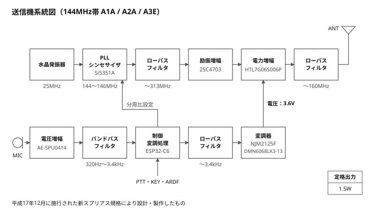
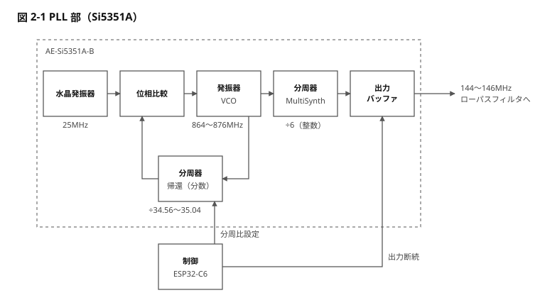

# 送信機 系統図及び技術説明書（JARD 申請添付用）

## 1. 主要諸元

本機は Si5351A で 144MHz 帯の搬送波を直接作り、終段 HTL7G06S006P のドレイン電圧を変調して搬送波 1.5W を送出する送信機である。

| 項目 | 設定・仕様 | 備考 |
| --- | --- | --- |
| 電波の型式 | A1A、A2A、A3E | A2A はトーン 698Hz |
| 周波数範囲 | 144.000 〜 146.000 MHz | 20kHz ステップ。運用はバンドプランの区分内 |
| 定格出力 | 1.5 W（搬送波電力） | 変調ピーク時の尖頭電力 約 6W。0.5W / 0.1W に切替可 |
| 発振方式 | PLL 周波数シンセサイザ（Si5351A）による直接発振 | 秋月電子 AE-Si5351A-B を使用 |
| 基準発振 | 25.000 MHz 水晶振動子 | モジュール搭載 |
| PLL（VCO）周波数 | 864 〜 876 MHz | 出力周波数 × 6。PLL は分数分周 |
| 出力分周（MultiSynth） | 1/6 固定（偶数整数分周） | 出力デューティ 50%（2倍波の抑圧） |
| 励振増幅 | 2SC4703（A級、8V、Ic 35mA） | 出力 約 +22dBm |
| 電力増幅（終段） | HTL7G06S006P（C級） |  |
| 終段の電圧・入力 | ドレイン電圧 3.6V、電流 約 0.65A、入力 約 2.3W | 1.5W の搬送波時。ドレイン電圧は変調で 0 〜 7.2V |
| 変調方式 | 終段ドレイン変調 | A2A / A3E。A1A は搬送波の断続 |
| 変調器 | NJM2125F ＋ DMN6068LK3-13のシリーズパス | 8V から終段ドレインへ給電 |
| 制御・信号処理 | Seeed Studio XIAO ESP32-C6 | トーン生成・音声処理・PWM・周波数設定 |
| 電源 | DC 12.8V（4S LiFePO4、使用範囲 10.5 〜 17V） | 内部で 8V / 3.3V / 17.4V を生成 |
| スプリアス低減 | ローパスフィルタ（波形整形、定数k形、fc 313MHz）＋ ローパスフィルタ（出力、7次チェビシェフ、fc 160MHz） |  |
| 空中線端子 | 50Ω 不平衡 |  |

## 2. 送信機系統図

上段が高周波系、下段が変調系である。両者は、MCU から PLL シンセサイザへの分周比設定（I2C、出力の断続を含む）と、変調器から電力増幅へのドレイン給電の 2か所でつながる。

**本機は、平成17年12月に施行された新スプリアス規格により設計・製作したものである。**

### 2-1 PLL 部（Si5351A）

周波数を変えるときは PLL の帰還分周比だけを書き換え、MultiSynth は ÷6 のまま固定する。MCU が I2C で設定するのは、帰還分周比と出力段の ON / OFF の 2つである。

## 3. 各部の構成と動作

高周波系は入口から出口まで振幅一定で動作し、変調は終段のドレイン電源にだけ加える。ゲート側には変調信号を入れない。

### (1) 高周波発振・周波数制御部

- **基準発振：** Si5351A モジュールに搭載の 25.000MHz 水晶振動子を基準とする。
- **PLL・分周：** 内部 PLL で 864 〜 876MHz を発振し、MultiSynth を 1/6（偶数整数）に固定して 144 〜 146MHz を出力端子から方形波で取り出す。周波数の変更は PLL 側の分周比だけで行う。
- **偶数整数分周の理由：** 出力デューティがほぼ 50% になり、2倍波が原理的にほとんど発生しない。
- **周波数制御：** MCU から I2C で設定する。周波数は 20kHz ステップ、範囲はファームウェアで 144.000 〜 146.000MHz に制限している。
- **待機中：** Si5351A の出力段をパワーダウンし、待機中の漏れを防ぐ。

### (2) ローパスフィルタ（波形整形）・励振増幅

- **直流阻止とパッド：** Si5351A の出力の直後に 1000pF の直流阻止と 3dB の π 型パッド（18Ω / 300Ω）を置き、フィルタの信号源インピーダンスを 50Ω に保つ。
- **ローパスフィルタ（波形整形）：** 47nH × 3、22pF × 3 の定数k形 LPF（fc 313MHz）。方形波の 3倍波を約 42dB 減衰させ、正弦波にして励振増幅へ送る。145MHz での挿入損失は約 0.3dB。2倍波は偶数分周により発振段でほとんど発生しないため、遮断周波数を 2倍波より上に置き、145MHz での損失を小さくしている。空中線端子での高調波の抑圧は出力のローパスフィルタが受け持つ。
- **励振増幅：** 2SC4703 のエミッタ接地増幅（8V、Ic 35mA、A級）。約 −1dBm を約 +22dBm まで増幅する。電源を 8V にしているのは Vcbo 25V に余裕を持たせるため。

### (3) 終段電力増幅部・出力フィルタ

- **終段：** HTL7G06S006P（LDMOS）を C級で飽和動作させる。ゲートバイアスは半固定抵抗で しきい値の少し下（無信号時ドレイン電流ほぼ 0）に合わせる。
- **ドレイン給電：** 変調器の出力を 0.47µH 空芯チョークを通して終段ドレインへ供給する。搬送波時のドレイン電圧は 3.6V で、出力はドレイン電圧の 2乗に比例する。
- **ローパスフィルタ（出力）：** 7次チェビシェフ（0.1dB リップル、fc 160MHz、CLCLCLC 構成、空芯コイル）。2倍波（約 290MHz）で約 50dB、3倍波（約 435MHz）を含むそれより上を減衰させる。145MHz での挿入損失は約 0.5dB。

### (4) 変調部

変調信号は MCU が PWM で作り、アナログのローパスフィルタ（平滑）と変調器を経て終段のドレイン電圧になる。DAC と低周波電力増幅 IC は使っていない。

- **PWM：** 250kHz・8bit。デューティを 25kHz ごとに更新し、搬送波レベル（直流）と変調波形（交流）を一緒に出す。
- **ローパスフィルタ（平滑）：** 1kΩ ＋ 47nF の RC 2段（fc 約 3.4kHz）。250kHz の PWM 成分を約 75dB 減衰させる。
- **変調器：** オペアンプ NJM2125F（電源 17.4V）が パス MOSFET  DMN6068LK3-13(電源 8.0V）のソースフォロワを負帰還で制御するシリーズパス型。平滑後の電圧を 3.2倍して終段ドレインへ供給する。電源は 8.0V なので、ドレイン電圧は構造上 8.0V を超えない。
- **出力の制限：** ファームウェアでデューティの上限を設け、ドレイン電圧が 7.75V を超えないようにしている。
- **出力の切替：** 1.5W / 0.5W / 0.1W の 3段。搬送波点のドレイン電圧を 3.6V / 2.08V / 0.93V に下げて切り替える（出力はドレイン電圧の 2乗に比例）。変調度は出力によらず同じで、送信中は切り替えられない。

### (5) 音声入力部（A3E）

- **マイク：** MEMS マイクモジュール AE-SPU0414（アンプ内蔵）。
- **入力回路：** 0.01µF の交流結合と 1.65V のバイアス（ハイパス fc 約 320Hz）、1kΩ ＋ 47nF のアンチエイリアス（fc 約 3.4kHz）を経て MCU の ADC（25kHz サンプリング）へ入れる。
- **デジタル処理（MCU）：** 300Hz ハイパス → 周波数特性の補償 → コンプレッサ → リミッタ → 3kHz ローパス（2次以上）。リミッタで変調の谷を 85%（ドレイン 0.54V）までに抑え、搬送波が切れることによるスプラッタを防ぐ。

### (6) 電源部

- **入力：** 12.8V（4S LiFePO4）。逆接保護とポリスイッチ（PPTC）を経て各レギュレータへ。
- **8V：** 降圧 DC-DC（RT8250）。励振増幅と変調器（終段ドレイン）に供給。
- **3.3V：** MCU 用に降圧 DC-DC、Si5351A 用に専用の LDO を別に置く（周波数基準を MCU の電源変動から切り離すため）。
- **17.4V：** 倍電圧チャージポンプ（NJW4190M）。変調器のオペアンプ専用。
- **電池電圧監視：** 10.5V を下回ると MCU が送信を禁止する。

## 4. 電波型式ごとの送出動作

3つの型式は高周波系が共通で、違いは MCU が作る変調信号と Si5351A の出力の扱いだけである。いずれの型式もキーイングの立ち上がり・立ち下がりを 5ms のレイズドコサインでなまらせ、クリックによる帯域の広がりを防ぐ。

| 電波型式 | 搬送波 | 変調 | 占有周波数帯幅の目安 |
| --- | --- | --- | --- |
| A1A（電信） | 押しボタン（電鍵として使用）の操作に合わせて断続。キーダウンでドレイン電圧を 0V から選択中の出力の搬送波レベルへ上げ、キーアップで 0V に下げてから Si5351A の出力を止める | なし | 約 0.5kHz 以下 |
| A2A（可聴周波数変調電信） | 送信中は連続して出す | 内蔵キーヤの符号に合わせて 698Hz の正弦波トーンを断続し、ドレイン電圧を変調する（変調度 約 80%） | 約 1.5kHz |
| A3E（振幅変調） | 送信中は連続して出す | 300Hz 〜 3kHz に帯域制限した音声でドレイン電圧を変調する（リミッタで谷を 85% までに制限） | 6kHz 以下 |

- **送信の開始：** Si5351A の PLL のロックを待って出力を有効にしてから、ドレイン電圧を 5ms かけて 0V から上げる。
- **送信の停止：** ドレイン電圧を 5ms かけて 0V まで下げ、10ms 待ってから Si5351A の出力を止める。
- **キーイング：** A1A は押しボタンを電鍵として使い、手動で断続する。A2A の符号は MCU 内蔵のキーヤが生成し、手動のキーイングは行わない（ARDF 用の自動送信。各送信の先頭でコールサインを送出）。外部電鍵の端子は持たない。
- **トーン：** MCU 内で正弦波を合成するので、方形波トーンのような奇数次の側波帯は出ない。
- **安全機構：** ウォッチドッグでファームウェアの停止を検出して送信を止める。リセット時は PWM の端子がプルダウンで 0V になり、ドレイン電圧 0V（送信停止）に落ちる。

## 5. スプリアス規格への適合

定格出力 1.5W は無線設備規則 別表第三号の「1W を超え 50W 以下」の区分に当たり、許容値は帯域外領域が 1mW 以下かつ基本周波数の平均電力より 60dB 低い値、スプリアス領域が搬送波電力より 60dB 低い値である。下表の「本機の実測」は、空中線端子での測定後に記入する。

### 対策

1. **2倍波：** MultiSynth を偶数整数分周（1/6）に固定して出力デューティを 50% にし、発振段で 2倍波を抑える。終段の 2倍波は出力のローパスフィルタで落とす。
2. **2段のフィルタ：** 発振直後のローパスフィルタ（波形整形。方形波の高調波を除去）と、空中線端子直前のローパスフィルタ（出力。終段の高調波を除去）の 2か所に置く。
3. **変調系の残留成分：** トーンも音声も正弦波で合成し、PWM（250kHz）と更新レート（25kHz）の残留を平滑用のローパスフィルタで落とす。
4. **占有帯域：** 音声の 300Hz 〜 3kHz の帯域制限と非対称リミッタ、キーイングのエンベロープ整形で、帯域外への広がりを抑える。
5. **待機中・キーアップ中：** Si5351A の出力を止め、ドレイン 0V でも残る漏れ（終段の帰還容量経由）を出さない。

### 設計値と実測値

| 成分 | 周波数 | 許容値 | 設計値 | 試作（フィルタ単体） | 本機の実測 |
| --- | --- | --- | --- | --- | --- |
| PLL 分数分周の近傍スプリアス | 搬送波近傍 | −60 dBc 以下 | — | — |  |
| 2倍波 | 約 290 MHz | −60 dBc 以下 | 約 −65 dBc（終段 −15dBc ＋ LPF −50dB） | LPF −53 dB |  |
| 3倍波 | 約 435 MHz | −60 dBc 以下 | LPF −78 dB（計算） | LPF −41 dB |  |
| 4倍波以上 | 580 MHz 〜 1 GHz | −60 dBc 以下 | — | — |  |
| 更新レートの折返し | 搬送波 ± 24.3 kHz | −60 dBc 以下 | −64.5 dBc | — |  |
| PWM の残留 | 搬送波 ± 250 kHz | −60 dBc 以下 | −73.3 dBc | — |  |
| 電源（8V 降圧 DC-DC）のスイッチング | 搬送波 ± 340 kHz | −60 dBc 以下 | — | — |  |
| 電源（3.3V 降圧 DC-DC）のスイッチング | 搬送波 ± 570 kHz | −60 dBc 以下 | — | — |  |

測定条件：空中線端子に 50Ω ダミーロードを接続し、減衰器を通して測定する。出力は最大の 1.5W に設定する。帯域外領域は無変調、スプリアス領域は変調状態で測る。測定器：（記入）。測定日：（記入）。
